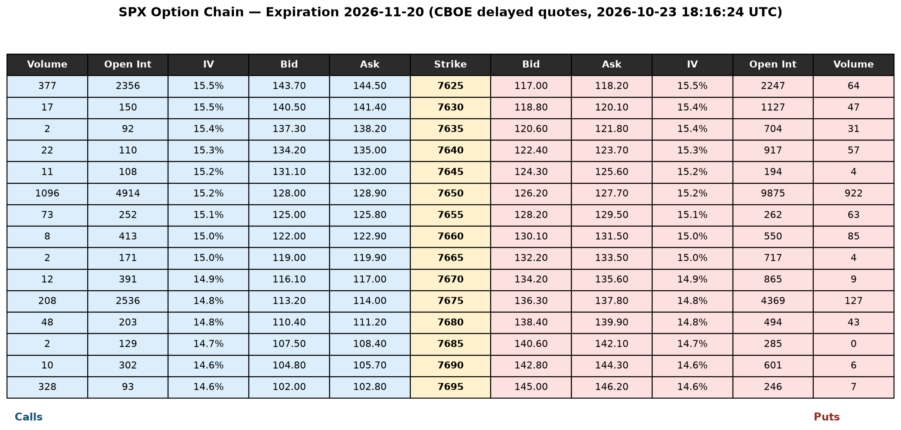

# Part 1: What We're Building Toward

## Recap: The Tools From Module 9

- **Martingale**: $E[X(t+s)\mid\mathcal{F}_t] = X(t)$ — the precise definition of a fair game
- **Itô's lemma**: for $dX = \mu(X,t)\,dt + \sigma(X,t)\,dW$ and twice-differentiable $f$,
$$
df = \left(\frac{\partial f}{\partial t} + \mu(X,t) \frac{\partial f}{\partial x} + \tfrac{1}{2}\sigma(X,t)^2 \frac{\partial^2 f}{\partial x^2}\right) dt + \sigma(X,t) \frac{\partial f}{\partial x}\, dW
$$
- **Geometric Brownian Motion**: $dS = \mu S\, dt + \sigma S\, dW \;\Rightarrow\; S(t) = S(0)\,e^{(\mu - \sigma^2/2)t + \sigma W(t)}$

Today we combine all three into a single result: a closed-form price for a European option.


## Recap: In-Work Problem 1

**Setup:** $dX_t = \mu X_t\,dt + \sigma X_t\,dW_t$ with $\mu \in \mathbb{R}$, $\sigma \in \mathbb{R}^+$. Define $Y_t = \ln(X_t)$.

Apply Itô's lemma with $f(x) = \ln(x)$, so $\dfrac{\partial f}{\partial x} = 1/x$, $\dfrac{\partial^2 f}{\partial x^2} = -1/x^2$, $\dfrac{\partial f}{\partial t} = 0$:

$$
dY_t  = \left(\mu - \tfrac{1}{2}\sigma^2\right) dt + \sigma\, dW_t
$$

**Takeaway:** the log of a GBM is itself an arithmetic Brownian motion — exactly how we got the closed form $S(t) = S(0)e^{(\mu-\sigma^2/2)t + \sigma W(t)}$ in Module 9.

## Recap: In-Work Problem 2

**Setup:** $dX_t = \mu\,dt + \sigma\,dW_t$ with $\mu \in \mathbb{R}$, $\sigma \in \mathbb{R}^+$. Define $Y_t = \exp(X_t)$.

Apply Itô's lemma with $f(x) = e^x$, so $\dfrac{\partial f}{\partial x} = \dfrac{\partial^2 f}{\partial x^2} = e^x = Y_t$, $\dfrac{\partial f}{\partial t} = 0$:

$$
dY_t = \left(\mu  + \tfrac{1}{2}\sigma^2 \right)Y_t dt + \sigma Y_t\, dW_t
$$

**Takeaway:** exponentiating an arithmetic Brownian motion produces GBM-like dynamics — the extra $\tfrac{1}{2}\sigma^2 Y_t$ drift is the same convexity ("Itô correction") term that shows up throughout this module.


## The Goal

Owning a **European call option** with strike $K$ and maturity $T$ gives you the right (not obligation) to buy the stock at $T$ for $K$ dollars. So the time $T$ payoff is 
$$
\max(S(T) - K, 0)
$$ 

Owning a **European put option** with strike $K$ and maturity $T$ gives you the right (not obligation) to sell the stock at $T$ for $K$ dollars. So the time $T$ payoff is 
$$
\max(K-S(T), 0)
$$


**Question:** What should this cost at time $t < T$?

## Call and Put Payoffs

```{python}
#| label: module10-call-put-payoff
#| eval: true
#| output-location: slide
import numpy as np
import matplotlib.pyplot as plt

def plot_payoff(S_T, payoff, title, K_lines=None):
    fig, ax = plt.subplots(figsize=(8, 5))
    ax.plot(S_T, payoff, color="C0", lw=2.5)
    ax.axhline(0, color="black", lw=0.8)
    if K_lines:
        for k, lbl in K_lines:
            ax.axvline(k, color="C3", ls="--", lw=1, label=lbl)
        ax.legend()
    ax.set_xlabel("$S(T)$")
    ax.set_ylabel("Payoff at $T$")
    ax.set_title(title)
    plt.tight_layout()
    plt.show()

K = 100.0
S_T = np.linspace(50, 150, 400)

fig, axes = plt.subplots(1, 2, figsize=(11, 4.5))

axes[0].plot(S_T, np.maximum(S_T - K, 0), color="C0", lw=2.5)
axes[0].axhline(0, color="black", lw=0.8)
axes[0].axvline(K, color="C3", ls="--", lw=1, label=f"$K={K:.0f}$")
axes[0].set_xlabel("$S(T)$")
axes[0].set_ylabel("Payoff at $T$")
axes[0].set_title("Call Payoff")
axes[0].legend()

axes[1].plot(S_T, np.maximum(K - S_T, 0), color="C1", lw=2.5)
axes[1].axhline(0, color="black", lw=0.8)
axes[1].axvline(K, color="C3", ls="--", lw=1, label=f"$K={K:.0f}$")
axes[1].set_xlabel("$S(T)$")
axes[1].set_title("Put Payoff")
axes[1].legend()

plt.tight_layout()
plt.show()
```

## A Real Option Chain: SPX

{width="85%" fig-align="center"}

Which ones would you buy or sell and why?

## TLDR (for Gamblers/Traders/Investors)

The price of a European option is the **present value of its expected payoff at expiration**.

If you hold the position until expiration,

 - this is a formula of $\mu$ and $\sigma$;
 - if your model is correct, your average profit will converge to the expected profit **by the law of large numbers;**
 - so you will use it mostly to screen for what options are expensive and which are cheap,

If you plan on selling the position before expiration: 

 - you can take some derivatives of this function and plug it into Itô's lemma;
 - Itô's lemma will tell you what happens in the short term.

## TLDR (for Market-Makers/Hedgers)

The price of a European option is (still) the **present value of its expected payoff at expiration**.

 - your $\mu$ is not estimated because **it must be set to the risk-neutral rate**;
 - this makes the discounted stock and option price both martingales;
 - this precludes the possibility of arbitrage;
 - your profits are coming from collecting the bid-ask spread, and maybe attempting that arb;  
 - you don't estimate $\sigma$ from historical data; instead you choose the value that explains the current price;
 - different derivatives of the price formula give you decision-making tools for your automated trading system;
 - you are not forecasting and you're not assuming any risk (if GBM is the true model for stock).


## Two Routes to the Same Answer

1. **Replication / no-arbitrage (Part 3):** build a portfolio of stock and cash that exactly reproduces the option's payoff at every instant. If it does, its price today must equal the option's price — otherwise there's an arbitrage opportunity.
2. **Risk-neutral pricing (Part 4):** reweight probabilities so the *discounted* stock price becomes a martingale, then the option price is just a discounted expectation.

Both use Itô's lemma. Both land on the same PDE and the same closed-form price.

# Part 2: Common Option Trading Strategies

## Covered Call

- **Construction:** own the stock, sell (write) one call option against it at strike $K > S(t)$
- **Payoff at $T$:** $S(T) - \max(S(T)-K, 0)$ — capped upside above $K$, full downside exposure below
$$
S(T) - \max(S(T)-K, 0) = \begin{cases} S(T), & S(T) \le K \\ K, & S(T) > K \end{cases}
$$
- **Motivation:** collect the option premium today in exchange for giving up gains beyond $K$ — a bet that the stock won't rally much before $T$
- **Risk profile:** same downside as holding the stock outright, cushioned by the premium received

```{python}
#| label: module10-covered-call-payoff
#| eval: true
#| output-location: fragment
K = 100.0
S_T = np.linspace(50, 150, 400)
payoff = S_T - np.maximum(S_T - K, 0)
plot_payoff(S_T, payoff, "Covered Call Payoff", K_lines=[(K, f"$K={K:.0f}$")])
```

## Protective Put

- **Construction:** own the stock, buy one put option at strike $K$
- **Payoff at $T$:** $S(T) + \max(K - S(T), 0)$ — downside floored at $K$ (less the put's cost), upside uncapped
$$
S(T) + \max(K-S(T), 0) = \begin{cases} K, & S(T) < K \\ S(T), & S(T) \ge K \end{cases}
$$
- **Motivation:** insurance — pay a premium today to guarantee you can sell at $K$ no matter how far the stock falls
- **Risk profile:** mirrors owning the stock with a floor; max loss is $S(t) - K + \text{premium paid}$

```{python}
#| label: module10-protective-put-payoff
#| eval: true
#| output-location: fragment
K = 100.0
S_T = np.linspace(50, 150, 400)
payoff = S_T + np.maximum(K - S_T, 0)
plot_payoff(S_T, payoff, "Protective Put Payoff", K_lines=[(K, f"$K={K:.0f}$")])
```

## Bull Call Spread

- **Construction:** buy one call at strike $K_1$, sell one call at a higher strike $K_2 > K_1$, same maturity $T$
- **Payoff at $T$:** $\max(S(T)-K_1,0) - \max(S(T)-K_2,0)$ — capped between $0$ and $K_2 - K_1$
$$
\max(S(T)-K_1,0) - \max(S(T)-K_2,0) = \begin{cases} 0, & S(T) \le K_1 \\ S(T) - K_1, & K_1 < S(T) \le K_2 \\ K_2 - K_1, & S(T) > K_2 \end{cases}
$$
- **Motivation:** selling the $K_2$ call finances part of the $K_1$ call's cost — a cheaper, lower-risk bet that the stock rises, in exchange for giving up gains past $K_2$
- **Risk profile:** max loss = net premium paid; max gain = $K_2 - K_1 - \text{net premium}$

```{python}
#| label: module10-bull-spread-payoff
#| eval: true
#| output-location: fragment
K1, K2 = 90.0, 110.0
S_T = np.linspace(50, 150, 400)
payoff = np.maximum(S_T - K1, 0) - np.maximum(S_T - K2, 0)
plot_payoff(S_T, payoff, "Bull Call Spread Payoff", K_lines=[(K1, f"$K_1={K1:.0f}$"), (K2, f"$K_2={K2:.0f}$")])
```

## Long Straddle

- **Construction:** buy one call and one put, same strike $K$ (usually $\approx S(t)$) and maturity $T$
- **Payoff at $T$:** $\max(S(T)-K,0) + \max(K-S(T),0) = |S(T) - K|$
$$
\max(S(T)-K,0) + \max(K-S(T),0) = \begin{cases} K - S(T), & S(T) \le K \\ S(T) - K, & S(T) > K \end{cases}
$$
- **Motivation:** a bet on volatility, not direction — profits if the stock moves far enough either way to cover both premiums
- **Risk profile:** max loss = both premiums paid (at $S(T) = K$ exactly); unlimited upside in either direction

```{python}
#| label: module10-straddle-payoff
#| eval: true
#| output-location: fragment
K = 100.0
S_T = np.linspace(50, 150, 400)
payoff = np.abs(S_T - K)
plot_payoff(S_T, payoff, "Long Straddle Payoff", K_lines=[(K, f"$K={K:.0f}$")])
```

# Part 3: Replication and the Black-Scholes PDE

## Setting Up a Hedge

Let $V(t, S)$ denote the call option's value when the stock is at $S$ at time $t$. 

We don't have an explicit formula for this at this moment. However, 

$$
V(T,S) = \max(S(T) - K, 0)
$$


We're going to use Itô, but we can't plug and chug right away. 

## Setting Up a Hedge

Build a portfolio $\Pi$ by holding the option (short one) and $\Delta$ shares of stock:

$$
\Pi = -V + \Delta S
$$

Apply Itô's lemma to $V(t, S(t))$, using $dS = \mu S\,dt + \sigma S\,dW$:

$$
dV = \left(\frac{\partial V}{\partial t} + \mu S \frac{\partial V}{\partial S} + \tfrac{1}{2}\sigma^2 S^2 \frac{\partial^2 V}{\partial S^2}\right) dt + \sigma S \frac{\partial V}{\partial S}\, dW
$$

## Eliminating the Randomness

The portfolio's change is $d\Pi = -dV + \Delta\, dS$. Substituting:

$$
d\Pi = \left[-\frac{\partial V}{\partial t} - \mu S \frac{\partial V}{\partial S} - \tfrac{1}{2}\sigma^2 S^2 \frac{\partial^2 V}{\partial S^2} + \Delta \mu S\right] dt + \sigma S\left[\Delta - \frac{\partial V}{\partial S}\right] dW
$$

Choose $\Delta = \dfrac{\partial V}{\partial S}$ (the **delta hedge**) — this exact choice makes the $dW$ term vanish entirely:

$$
d\Pi = \left(-\frac{\partial V}{\partial t} - \tfrac{1}{2}\sigma^2 S^2 \frac{\partial^2 V}{\partial S^2}\right) dt
$$

**Notice $\mu$ dropped out too** — it only appeared multiplying $\Delta$ and $\dfrac{\partial V}{\partial S}$, which just canceled once we set them equal.

## No Arbitrage Pins Down the Return

$\Pi$ is now **riskless** — no $dW$ term, so its value evolves deterministically. A riskless portfolio must earn exactly the risk-free rate $r$, or there's an arbitrage (borrow at $r$ to buy it if it earns more; short it and lend at $r$ if it earns less):

$$
d\Pi \stackrel{\text{set}}{=} r\Pi\,dt = r\left(-V + S\frac{\partial V}{\partial S}\right) dt
$$

Setting the two expressions for $d\Pi$ equal and rearranging gives the **Black-Scholes PDE**:

$$
\frac{\partial V}{\partial t} + rS\frac{\partial V}{\partial S} + \tfrac{1}{2}\sigma^2 S^2 \frac{\partial^2 V}{\partial S^2} - rV = 0
$$

with terminal condition $V(T, S) = \max(S - K, 0)$ for a call. Solving this PDE is the rest of the module.

# Part 4: Risk-Neutral Pricing


## The "Real-World" measure

- Data scientists try to learn $\mathbb{P}$, the "real-world measure", by looking at data. If you learn it correctly, you can make good forecasts/predictions, and thereby make good decisions. 

- Buy side firms will buy options they think are undervalued, and sell assets they think are overvalued. What they think the price is comes from their model/estimate of $\mathbb{P}$ the **real world measure.**

- This is the measure for gamblers. Gamblers need to be good data scientists and learn from data.

## The "Risk-Neutral" measure


- On the other hand, current option prices "imply" a distribution for the underlying stock. The measure $\mathbb{Q}$ is called the **risk neutral measure**.

- Roughly, the current price of an option is "what the market thinks." We'll see prices are expectations, so think of taking the current price, and solving for the market's beliefs $\mathbb{Q}$.

- To say it more precisely, $\mathbb{Q}$ is the measure that option market makers need to use to be able to hedge their options positions in the underlying stock. Anyone who needs to hedge to zero-out wiggliness in their PnL needs to use this. 

- The market maker puts out a bunch of limit orders and waits. They do not estimate parameters from historical data at all. Once a market order comes and gives them a position, that fill information is fed into the algorithm that auto-hedges that exposure in the stock market.


## The "Risk-Neutral" measure

Two different measures, two different "beliefs", means we have two different standard Brownian motions: $W_t^\mathbb{P}$ and $W_t^\mathbb{Q}$.

Girsanov's theorem says they differ by a deterministic drift shift, not by anything random: with $\theta = \dfrac{\mu - r}{\sigma}$ (the **market price of risk**),

$$
W_t^{\mathbb{Q}} = W_t^{\mathbb{P}} + \theta t
$$


## The "Risk-Neutral" measure

Weirdly, each one is a standard Brownian motion — but only under its *own* measure:

$$
\mathbb{E}_{\mathbb{P}}[dW_t^\mathbb{P}] = 0 \hspace{10mm} \mathbb{V}_{\mathbb{P}}[dW_t^\mathbb{P}] = dt
$$

and

$$
\mathbb{E}_{\mathbb{Q}}[dW_t^\mathbb{Q}] = 0 \hspace{10mm} \mathbb{V}_{\mathbb{Q}}[dW_t^\mathbb{Q}] = dt
$$

## The "Risk-Neutral" measure


But when you evaluate them with the other measure, it's not "standard" Brownian motion anymore — it picks up a deterministic drift:

$$
\mathbb{E}_{\mathbb{Q}}[dW_t^{\mathbb{P}}] = -\theta\,dt \neq 0 \hspace{10mm} \mathbb{V}_{\mathbb{Q}}[dW_t^{\mathbb{P}}] = dt
$$

$$
\mathbb{E}_{\mathbb{P}}[dW_t^{\mathbb{Q}}] = \theta\,dt \neq 0 \hspace{10mm} \mathbb{V}_{\mathbb{P}}[dW_t^{\mathbb{Q}}] = dt
$$

Same randomness (the variance doesn't change), but a nonzero mean — exactly the drift that Girsanov's theorem swaps between $\mu$ and $r$.


## The "Risk-Neutral" measure

Substitute $dW_t^{\mathbb{P}} = dW_t^{\mathbb{Q}} - \theta\,dt$ into the stock's $\mathbb{P}$-dynamics and watch the drift change:

$$
\begin{aligned}
dS &= \mu S\,dt + \sigma S\,dW_t^{\mathbb{P}} \\
&= \mu S\,dt + \sigma S\left(dW_t^{\mathbb{Q}} - \theta\,dt\right) \\
&= (\mu - \sigma\theta)\,S\,dt + \sigma S\,dW_t^{\mathbb{Q}} \\
&= \left(\mu - \sigma \cdot \tfrac{\mu - r}{\sigma}\right) S\,dt + \sigma S\,dW_t^{\mathbb{Q}} \\
&= rS\,dt + \sigma S\,dW_t^{\mathbb{Q}}
\end{aligned}
$$

The $\mu$'s cancel by design — $\theta$ was chosen exactly to make this happen. This is precisely the Girsanov result the next slide states.


## The Same Idea, From a Different Angle

The PDE derivation is mechanical but opaque about *why* $\mu$ disappears. Risk-neutral pricing makes it a definition rather than a coincidence.

**Key fact (Girsanov's theorem, stated without proof):** there exists a probability measure $\mathbb{Q}$, equivalent to the real-world measure, under which

$$
dS = rS\,dt + \sigma S\, dW^{\mathbb{Q}}
$$

i.e. under $\mathbb{Q}$ the stock's drift is $r$ instead of $\mu$, with the *same* volatility $\sigma$. 

- Under $\mathbb{Q}$, the discounted price $e^{-rt}S(t)$ is a martingale — literally the fair-game condition from Module 9, applied to the traded asset itself.

## Checking the Martingale Claim

Let $Y_t = e^{-rt}S(t)$. Apply Itô's lemma to $Y(t,S) = e^{-rt}S$, using $dS = rS\,dt + \sigma S\,dW^{\mathbb{Q}}$:

$$
\frac{\partial Y}{\partial t} = -re^{-rt}S, \qquad \frac{\partial Y}{\partial S} = e^{-rt}, \qquad \frac{\partial^2 Y}{\partial S^2} = 0
$$

$$
\begin{aligned}
dY_t &= \left(\frac{\partial Y}{\partial t} + rS\frac{\partial Y}{\partial S} + \tfrac{1}{2}\sigma^2 S^2 \frac{\partial^2 Y}{\partial S^2}\right) dt + \sigma S \frac{\partial Y}{\partial S}\, dW_t^{\mathbb{Q}} \\
&= \left(-re^{-rt}S + rSe^{-rt} + 0\right) dt + \sigma S e^{-rt}\, dW_t^{\mathbb{Q}} \\
&= 0\,dt + \sigma e^{-rt}S\, dW_t^{\mathbb{Q}} \\
&= \sigma Y_t\, dW_t^{\mathbb{Q}}
\end{aligned}
$$

**No drift term survives** — $dY_t$ is pure diffusion, exactly what it means for $Y_t$ to be a martingale under $\mathbb{Q}$. The diffusion coefficient, $\sigma Y_t$, says the discounted price inherits the *same percentage volatility* $\sigma$ as the stock itself — only the drift got erased.

## Pricing as a Discounted Expectation

If the option can be replicated by trading the stock and cash (Part 3 showed it can), no-arbitrage forces:

$$
V(t, S) = e^{-r(T-t)}\, E^{\mathbb{Q}}\!\left[V(T, S) \mid S(t) = S\right]
$$

— literally "discount the expected payoff," but under $\mathbb{Q}$, not the real-world measure. Since $dS = rS\,dt + \sigma S\,dW^{\mathbb{Q}}$ is GBM with drift $r$, Module 9's closed form applies directly:

$$
S(T) = S(t)\exp\!\left[\left(r - \tfrac{1}{2}\sigma^2\right)(T-t) + \sigma\sqrt{T-t}\, Z\right], \qquad Z \sim N(0,1)
$$

Computing this expectation in closed form (a standard, if tedious, Normal-integral calculation) gives the Black-Scholes formula.

## Why $\mu$ Never Appears

$\mu$ describes how investors expect the *stock* to perform — a real-world belief about risk and return. But the option is priced by **replication**, not by belief: the hedge in Part 3 only needs to track the stock's *moves*, controlled by $\sigma$, not its *drift*.

Two people who disagree wildly about $\mu$ (one bullish, one bearish) must still agree on the option's no-arbitrage price, given the same $S$, $K$, $T$, $r$, $\sigma$ — because both could construct the same replicating portfolio.

# Part 5: The Black-Scholes Formula

## The Closed-Form Price

For a non-dividend-paying stock, with $\tau = T - t$ time remaining:

$$
d_1 = \frac{\ln(S/K) + (r + \sigma^2/2)\tau}{\sigma\sqrt{\tau}}, \qquad d_2 = d_1 - \sigma\sqrt{\tau}
$$

$$
C = S\,N(d_1) - K e^{-r\tau} N(d_2), \qquad P = K e^{-r\tau} N(-d_2) - S\,N(-d_1)
$$

where $N(\cdot)$ is the standard Normal CDF. $C$ and $P$ solve the PDE from Part 3 with call/put terminal conditions, and are exactly the expectations from Part 4.

## Implementing the Formula

```{python}
#| label: module10-bs-formula
#| eval: true
#| output-location: fragment
import numpy as np
from scipy.stats import norm

def black_scholes(S, K, r, sigma, tau, option="call"):
    d1 = (np.log(S / K) + (r + 0.5 * sigma**2) * tau) / (sigma * np.sqrt(tau))
    d2 = d1 - sigma * np.sqrt(tau)
    if option == "call":
        return S * norm.cdf(d1) - K * np.exp(-r * tau) * norm.cdf(d2)
    return K * np.exp(-r * tau) * norm.cdf(-d2) - S * norm.cdf(-d1)

S, K, r, sigma, tau = 100.0, 100.0, 0.05, 0.25, 1.0
call_price = black_scholes(S, K, r, sigma, tau, "call")
put_price = black_scholes(S, K, r, sigma, tau, "put")
print(f"call price = {call_price:.4f}")
print(f"put price  = {put_price:.4f}")
```

## Checking Put-Call Parity

A model-free no-arbitrage identity, independent of Black-Scholes: $C - P = S - Ke^{-r\tau}$. Any correct pricing formula must satisfy it.

```{python}
#| label: module10-put-call-parity
#| eval: true
#| output-location: fragment
lhs = call_price - put_price
rhs = S - K * np.exp(-r * tau)
print(f"C - P            = {lhs:.4f}")
print(f"S - K e^(-r tau) = {rhs:.4f}")
```

## Verifying With Monte Carlo

Part 4's derivation says the price is a discounted expectation under $\mathbb{Q}$ (drift $r$, not $\mu$). Simulate GBM paths with drift $r$ directly and average the discounted payoff — no PDE, no closed form, just Module 9's simulator:

```{python}
#| label: module10-mc-price
#| eval: true
#| output-location: slide
import numpy as np
import matplotlib.pyplot as plt

np.random.seed(5005)
S, K, r, sigma, tau = 100.0, 100.0, 0.05, 0.25, 1.0
sample_sizes = np.unique(np.geomspace(50, 200_000, 40).astype(int))

Z_full = np.random.normal(size=sample_sizes[-1])
S_T_full = S * np.exp((r - 0.5 * sigma**2) * tau + sigma * np.sqrt(tau) * Z_full)
payoff_full = np.exp(-r * tau) * np.maximum(S_T_full - K, 0)

mc_estimates = [payoff_full[:n].mean() for n in sample_sizes]

fig, ax = plt.subplots(figsize=(9, 5))
ax.plot(sample_sizes, mc_estimates, color="C0", lw=1.5, label="Monte Carlo estimate")
ax.axhline(call_price, color="black", ls="--", lw=1.5, label=f"Black-Scholes closed form = {call_price:.4f}")
ax.set_xscale("log")
ax.set_xlabel("number of simulated paths")
ax.set_ylabel("call price estimate")
ax.set_title("Monte Carlo Convergence to the Black-Scholes Price")
ax.legend()
plt.tight_layout()
plt.show()
```

The Monte Carlo estimate — built entirely from simulating $S(T)$ under the risk-neutral drift $r$ and averaging the discounted payoff — converges to the closed-form price as the number of paths grows. Two completely different derivations (a PDE solved analytically, and a simulated expectation) agree, which is exactly what Part 1 promised.

## Sensitivity to $\sigma$, Not $\mu$

```{python}
#| label: module10-price-vs-sigma
#| eval: true
#| output-location: slide
import numpy as np
import matplotlib.pyplot as plt

S, K, r, tau = 100.0, 100.0, 0.05, 1.0
sigmas = np.linspace(0.05, 0.6, 100)
prices = [black_scholes(S, K, r, s, tau, "call") for s in sigmas]

fig, ax = plt.subplots(figsize=(9, 5))
ax.plot(sigmas, prices, color="C0", lw=2)
ax.set_xlabel(r"$\sigma$")
ax.set_ylabel("call price")
ax.set_title("Black-Scholes Call Price vs. Volatility (at fixed S, K, r, tau)")
plt.tight_layout()
plt.show()
```

Price is monotonically increasing in $\sigma$ — more volatility means more upside optionality with the same downside floor at 0 — and, as derived, changing $\mu$ in the simulation above would move the *stock's* expected path without moving this price at all. Try it: only $\sigma$, not $\mu$, is a free parameter here.

# Part 6: Looking Ahead to CS 4

## What This Buys Us

- A closed-form price, computable from five observable-or-agreed-upon inputs: $S, K, r, \sigma, \tau$
- A precise reason ($\mu$ cancels under replication) that pricing doesn't require forecasting the stock
- $\Delta = \dfrac{\partial V}{\partial S}$ from Part 3 is exactly the hedge ratio needed to manage risk on an option position — the subject of Module 11

## What's Still Open

Four of the five Black-Scholes inputs ($S, K, r, \tau$) are directly observable. The fifth, $\sigma$, is not — it's a model *assumption*, not a market quote. Module 11 confronts this directly: given a real market option price, what $\sigma$ makes Black-Scholes match it (**implied volatility**), and does a single constant $\sigma$ actually fit real options well?

## What We Learned: Module 10 Summary

| Concept | Role |
|---|---|
| Delta hedge, $\Delta = \partial V/\partial S$ | Chosen specifically to cancel the $dW$ term in the replicating portfolio |
| Black-Scholes PDE | $\partial V/\partial t + rS\,\partial V/\partial S + \tfrac{1}{2}\sigma^2S^2\,\partial^2 V/\partial S^2 - rV = 0$, from no-arbitrage on the hedged portfolio |
| Risk-neutral measure $\mathbb{Q}$ | Reweights probabilities so discounted $S(t)$ is a martingale, with drift $r$ replacing $\mu$ |
| $\mu$-invariance | The central result: option price depends on $\sigma$, not on the stock's real-world expected return |
| Black-Scholes formula | Closed-form $C, P$ in terms of $S, K, r, \sigma, \tau$ via $N(d_1), N(d_2)$ |
| Put-call parity | A model-free identity any correct pricing formula must satisfy |

## Looking Ahead: Module 11

Next module: **Black-Scholes implementation** — the Greeks ($\Delta, \Gamma, \text{Vega}, \Theta$), dynamic hedging in practice, implied volatility, and a direct confrontation with real data: does constant $\sigma$ actually describe how options trade, or does the market show a volatility smile the model can't capture? CS 4 (calibration and model limitations) is due at the end of Module 12.

## References

- Black, F. & Scholes, M. (1973). *The Pricing of Options and Corporate Liabilities*. Journal of Political Economy, 81(3), 637–654.
- Merton, R. C. (1973). *Theory of Rational Option Pricing*. The Bell Journal of Economics and Management Science, 4(1), 141–183.
- Shreve, S. (2004). *Stochastic Calculus for Finance II: Continuous-Time Models*. Springer.
- Hull, J. C. *Options, Futures, and Other Derivatives*.
